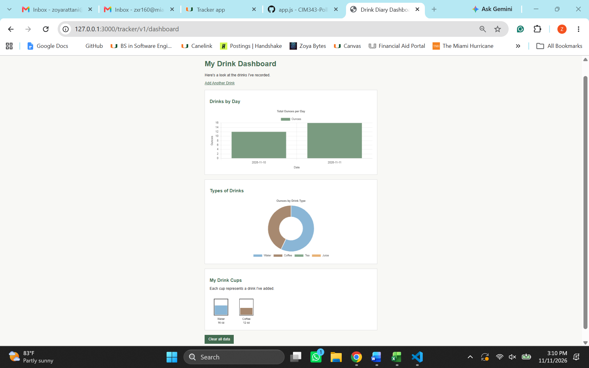
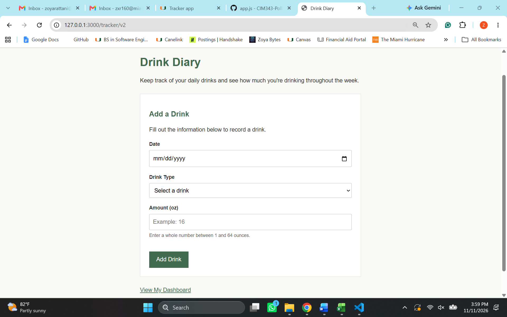
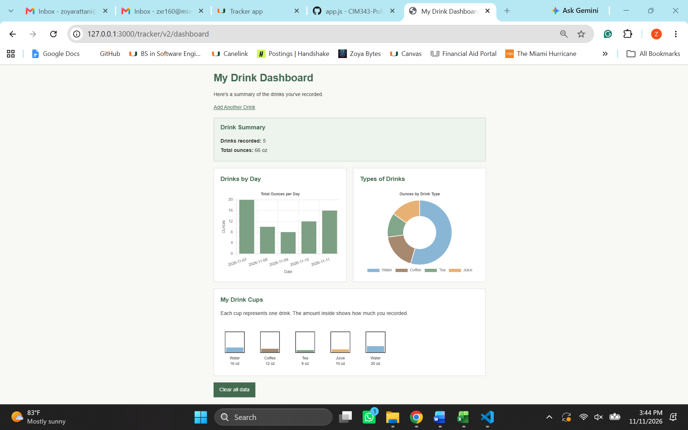
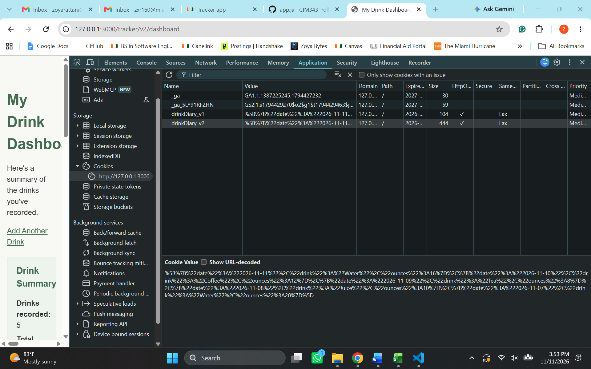

# Cookie Tracker – Drink Diary

**Course:** CIM 343 – Front End Fundamentals  
**Semester:** Fall 2026

**Video walkthrough:** [Add video link after recording]

## What I tracked and why

For this assignment, I made a website called Drink Diary that lets users record what they drink throughout the day. Each entry includes the date, type of drink, and amount in ounces.

I chose this idea because it's something simple that people can use in their everyday lives. I also thought it would be interesting to see how much of each drink someone has throughout the week.

The website uses Express.js and cookie-parser to save entries. It also has two Chart.js charts and a p5.js drawing to display the data in different ways.

## Version 1 (Prompt v1)

[View Prompt v1](tracker-docs/prompt-v1.md)

### Version 1 Dashboard



### What worked and what didn't

Most of Version 1 worked when I tested it. I was able to add drinks, and the dashboard updated to show the correct amounts. When I added another drink, both charts updated, and another cup appeared in the drawing.

I also refreshed the dashboard to see if the data would disappear, but everything was still there. The Clear all data button worked too.

One problem I found was that the form accepted 9999 ounces. Even though that isn't a realistic amount for one drink, the website still saved it. The form already prevented negative numbers and empty fields, but it didn't have a maximum amount.

I wanted to fix this in Version 2 and make a few other improvements.

## Version 2 – Final

[View Prompt v2 and Test Log](tracker-docs/prompt-v2.md)

For Version 2, I kept the same basic idea but improved the form validation and made the dashboard a little more organized.

### Final Form



The final form includes a date field, a dropdown for selecting the drink type, and an amount field.

I added a limit so users can only enter whole numbers between 1 and 64 ounces. I also included a short instruction underneath the amount field so users know what values are allowed.

### Final Dashboard



The dashboard shows the number of drinks recorded and the total ounces. It also includes a bar chart, a doughnut chart, and the p5.js cup drawing.

When I tested Version 2 with five entries, the summary displayed 5 drinks and 66 total ounces.

I kept the design simple, with a white background, muted green headings, basic borders, and straightforward navigation.

### Cookie Storage



The website uses cookies to save drink entries instead of storing them in a database.

Version 1 uses the cookie name `drinkDiary_v1`, while Version 2 uses `drinkDiary_v2`. This keeps the data from the two versions separate.

I checked Chrome DevTools under Application > Cookies and found the Version 2 cookie containing my saved entries.

The cookies last for seven days, and the code keeps up to 30 entries so the cookie doesn't become too large.

### Biggest Changes from Version 1

The biggest improvement was adding better form validation. In Version 1, users could enter amounts like 9999 ounces, but Version 2 only allows whole numbers between 1 and 64 ounces.

I also added a confirmation message before clearing the data. This way, users can cancel if they click the button by mistake.

Another change was adding a drink summary at the top of the dashboard. It shows how many drinks were recorded and the total ounces.

I kept the overall design simple because I wanted the website to be easy to use without adding too many unnecessary features.

## Testing and Improvements

I tested Version 1 before writing my second prompt. I wanted to see which parts were working and what could be improved.

| What I tested | What happened | What I wanted instead |
|---|---|---|
| Added 16 oz of water | The entry saved and appeared on the dashboard | Keep this working |
| Added 12 oz of coffee | Both charts and the cup drawing updated | Keep the charts connected to the saved data |
| Refreshed the dashboard | My saved entries were still there | Keep the data saved after refreshing |
| Left the amount empty | The browser asked me to fill out the field | Keep required field validation |
| Entered -5 ounces | The browser prevented submission | Keep blocking negative amounts |
| Entered 9999 ounces | Version 1 accepted it | Limit the amount to 1–64 ounces |
| Clicked Clear all data | Version 1 deleted the entries immediately | Add a confirmation before deleting |

### Testing Version 2

After making Version 2, I tested the new features.

| What I tested | What happened |
|---|---|
| Added five drink entries | The dashboard displayed 5 drinks and 66 total ounces |
| Checked both charts | The charts displayed the recorded dates and drink categories |
| Checked the p5.js sketch | Five cups appeared with the recorded amounts |
| Opened Chrome DevTools | I found the `drinkDiary_v2` cookie with my saved data |
| Entered 9999 ounces | The browser blocked the entry and showed the allowed range |
| Clicked Clear all data | A confirmation message appeared |
| Selected Cancel | My saved drinks stayed on the dashboard |

### What I learned from testing

Testing helped me notice issues that I wouldn't have caught just by looking at the website.

At first, Version 1 seemed to work because I could add drinks and see the charts update. But when I tried entering 9999 ounces, I realized that the form needed a better limit.

I made my second prompt more specific about the allowed values and how the form should handle invalid input.

I also realized that the Clear all data button could be frustrating if someone clicked it by mistake, so I added a confirmation message.

The changes were pretty small, but they made the final version easier to use.

## Hand Edits I Made

I added the generated code to my existing `app.js` file instead of creating a separate Express application.

I placed the Version 1 and Version 2 routes before the existing 404 handler so Express could recognize them. I also kept the routes from my previous poll assignment.

I created the prompt documentation files, saved screenshots from my testing, and updated the README.

I kept the Version 1 routes unchanged after testing so the original and improved versions could be compared.

## How My Code Works

The main code for both versions is located in [app.js](app.js).

### Saving the Cookie

This is the part of my Version 2 code that saves a drink after the submitted information passes validation.

```javascript
const drinks = readDrinkDiaryV2(req);

drinks.push({
  date: date,
  drink: drink,
  ounces: ounces
});

const recentDrinks = drinks.slice(-30);

res.cookie('drinkDiary_v2', JSON.stringify(recentDrinks), {
  maxAge: 7 * 24 * 60 * 60 * 1000,
  httpOnly: true,
  sameSite: 'lax'
});

res.redirect('/tracker/v2/dashboard');
```

**How it works:**

First, `readDrinkDiaryV2(req)` gets the drinks that were already saved in the cookie. This function uses `req.cookies` to access the saved information and turns it back into an array.

Next, `drinks.push()` adds the new drink to the list. Each entry includes the date, drink type, and amount in ounces.

I used `.slice(-30)` to keep only the 30 most recent entries. Since cookies have limited storage, I didn't want the list to keep getting bigger.

Then `res.cookie()` saves the updated list. I used `JSON.stringify()` because the array needs to be converted into text before it can be stored in the cookie.

The `maxAge` setting makes the cookie last seven days. I also used `httpOnly` so browser JavaScript can't directly read the cookie.

Finally, `res.redirect()` takes the user to the dashboard so they can see the updated information.

### Getting the Data to the Dashboard

This is the beginning of my Version 2 dashboard route.

```javascript
app.get('/tracker/v2/dashboard', function (req, res) {
  const drinks = readDrinkDiaryV2(req);

  const totalDrinks = drinks.length;

  const totalOunces = drinks.reduce(function (sum, entry) {
    return sum + Number(entry.ounces || 0);
  }, 0);

  const safeDrinks = JSON.stringify(drinks)
    .replace(/</g, '\\u003c');

  // The route continues by sending the dashboard HTML.
});
```

The full route is in [app.js](app.js).

The dashboard HTML also includes this line to make the saved data available to the charts and drawing:

```javascript
const entries = ${safeDrinks};
```

**How it works:**

When someone opens the dashboard, Express runs the route for `/tracker/v2/dashboard`.

The first thing it does is call `readDrinkDiaryV2(req)` to get the saved entries from the cookie. If there isn't any data saved, the function returns an empty array.

The code uses `drinks.length` to count how many drinks were recorded.

I used `.reduce()` to calculate the total ounces. It goes through each entry and adds the amounts together until it gets the final total.

The `safeDrinks` variable prepares the saved data so it can be included in the JavaScript on the dashboard page. Replacing the less-than character helps prevent the data from being interpreted as HTML.

The browser then uses the entries to build the two charts and the p5.js drawing.

### Chart 1 – Drinks by Day

The first chart is a bar chart showing the total ounces recorded each day.

```javascript
const dates = [...new Set(entries.map(function (entry) {
  return entry.date;
}))].sort();

const dailyTotals = dates.map(function (date) {
  return entries
    .filter(function (entry) {
      return entry.date === date;
    })
    .reduce(function (sum, entry) {
      return sum + entry.ounces;
    }, 0);
});
```

**How it works:**

I used `.map()` to get the date from each saved entry.

The `Set` removes repeated dates because someone might record more than one drink on the same day. Then `.sort()` puts the dates in order.

For each date, `.filter()` finds the entries that match that day. After that, `.reduce()` adds the ounces together.

For example, if someone records 16 ounces of water and 20 ounces of water on the same day, the chart shows 36 ounces for that date instead of making two separate bars.

The dates are shown on the x-axis, and the total ounces are shown on the y-axis.

I used a muted green color for the bars to match the rest of the website.

The numbers are calculated from the cookie data, so the chart changes whenever a drink is added.

### Chart 2 – Types of Drinks

The second chart is a doughnut chart showing the total ounces recorded for each drink category.

```javascript
const drinkTypes = ['Water', 'Coffee', 'Tea', 'Juice'];

const drinkTotals = drinkTypes.map(function (type) {
  return entries
    .filter(function (entry) {
      return entry.drink === type;
    })
    .reduce(function (sum, entry) {
      return sum + entry.ounces;
    }, 0);
});
```

**How it works:**

I made an array with the four drink categories: water, coffee, tea, and juice.

The code goes through each category and uses `.filter()` to find entries with that drink type. Then `.reduce()` adds the ounces together.

For example, if someone records water several times, the chart combines those amounts into one total for water.

Each drink type has a different color. Water is blue, coffee is brown, tea is green, and juice is orange.

I also included a legend underneath the chart so users can see what each color represents.

The chart doesn't use hard-coded numbers. It calculates everything from the saved entries, so the sections change when new drinks are recorded.

### p5.js Sketch – My Drink Cups

For the p5.js part, I created a drawing that shows a cup for each drink entry.

This calculation controls how much liquid appears inside each cup.

```javascript
const fillHeight = Math.min(entry.ounces / 64, 1) * 65;
```

The sketch also uses these colors:

```javascript
const colors = {
  Water: '#8ab6d6',
  Coffee: '#a78970',
  Tea: '#83a78a',
  Juice: '#e8b174'
};
```

**How it works:**

The sketch goes through the saved entries and draws one cup for each drink.

The amount of liquid depends on how many ounces were entered. I used 64 ounces as the maximum because that's the largest amount allowed in Version 2.

The calculation divides the ounces by 64 to figure out how full the cup should be. It then multiplies that number by 65 to turn it into the height of the liquid in the drawing.

For example, a 16-ounce drink fills about a quarter of the cup, while a 32-ounce drink fills about half.

I used different colors for each drink type so the drawing would be easier to understand.

The sketch also displays the drink name and the amount in ounces underneath each cup.

When another drink is added, another cup appears. If there are several entries, the cups are arranged in rows.

If there aren't any saved drinks, the sketch displays a message saying "No drinks logged yet."

I liked this part because it shows the same information as the charts but in a more visual way.

### Clearing the Cookie

This is the code that deletes the Version 2 data.

```javascript
app.post('/tracker/v2/dashboard', function (req, res) {
  res.clearCookie('drinkDiary_v2');
  res.redirect('/tracker/v2/dashboard');
});
```

**How it works:**

When someone clicks Clear all data and confirms the action, the dashboard sends a POST request to this route.

The `res.clearCookie()` function deletes the Version 2 cookie that contains the saved drink entries.

After that, `res.redirect()` takes the user back to the dashboard. Since the data has been deleted, the dashboard will show zero drinks and an empty drawing.

I made sure this only clears `drinkDiary_v2`, so it doesn't affect the data stored for Version 1.

I also added a confirmation popup before deleting anything. If the user clicks Cancel, the form doesn't submit, and their data stays saved.

## Something the AI Got Wrong

One issue with the first version was that the AI didn't include a maximum value for the amount field.

At first, I thought everything was working because I could add drinks and see the charts update. But when I tested the form with 9999 ounces, it accepted the number.

That showed me that even when a website works with normal inputs, it might still have problems with unexpected values.

For Version 2, I changed my prompt to be more specific. Instead of just asking for a number field, I explained that the amount needed to be a whole number between 1 and 64 ounces.

I also asked for server-side validation so Express would check the values before saving them.

When I tested the same 9999-ounce value in Version 2, the browser blocked it.

Another thing I learned was that I needed to be specific about the website's design. I wanted something simple and easy to understand, so I included instructions about the colors, fonts, spacing, and layout.

This assignment helped me understand why it's important to write detailed prompts, test the results, and make changes based on what actually happens.

## Running the Tracker

To run the Express application locally, open the terminal and enter:

```bash
npm install
npm start
```

The application runs on port 3000 by default.

### Version 1 Routes

**Tracker Form:**  
http://localhost:3000/tracker/v1

**Dashboard:**  
http://localhost:3000/tracker/v1/dashboard

### Version 2 Routes

**Tracker Form:**  
http://localhost:3000/tracker/v2

**Dashboard:**  
http://localhost:3000/tracker/v2/dashboard

### Technologies Used

- HTML
- CSS
- JavaScript
- Express.js
- cookie-parser
- Chart.js
- p5.js

Both tracker versions are part of the existing Express application. The routes are located in `app.js`, and each version stores its entries in a separate cookie.

---

# Previous Express and Poll Assignment

This repository also contains my previous CIM 343 poll assignment.

## Website Theme Color Poll

The question for my poll was:

**Which color would you choose for a website theme?**

The poll includes five options:

- Red
- Blue
- Yellow
- Green
- Purple

I added Green and Purple to the original class example.

The poll uses Express.js, Handlebars, SQLite, Sequelize, and Chart.js.

Users can vote for their preferred color, and the results are displayed in a bar chart.

### Poll Code

The poll page is located in `views/charts.hbs`.

[View my poll code](views/charts.hbs)

### How to Run the Poll

Start the application:

```bash
npm install
npm start
```

Then open:

http://localhost:3000/chart

## Other Express Application Features

My Express project also includes:

- Task management
- List management
- A website theme color poll
- A p5.js visualization
- The Drink Diary cookie tracker

The main Express routes are located in [app.js](app.js).

The Handlebars templates are stored in the `views` folder, and the static files are stored in the `public` folder.
